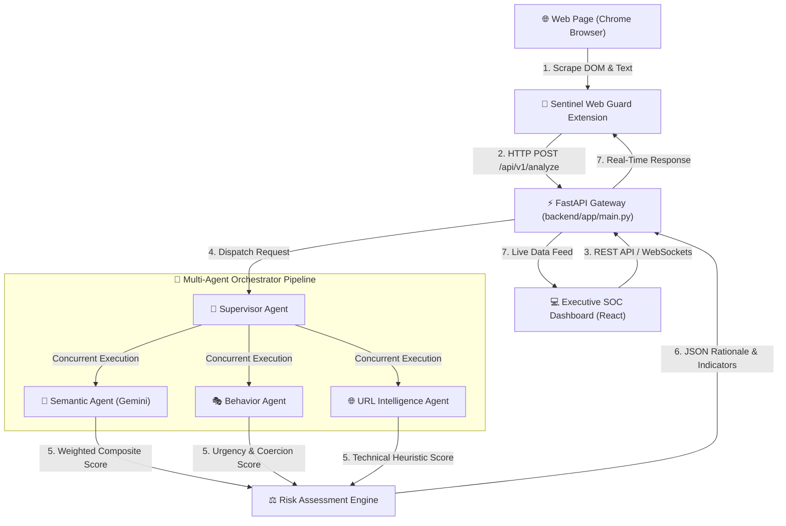

# 🛡️ SemanticShield AI

> **An Intelligent Agentic AI-Powered Platform for Phishing Simulation, Behavioral Threat Analysis, and Real-Time Browser Protection.**

[](https://www.python.org/)
[](https://fastapi.tiangolo.com/)
[](https://react.dev/)
[](https://developer.chrome.com/docs/extensions/mv3/intro/)
[](https://opensource.org/licenses/MIT)

---

## 📌 1. Project Title
**SemanticShield AI**: *An Intelligent Agent for Phishing Simulation and Behavioral Threat Analysis*

---

## 🎯 2. Project Objective
SemanticShield AI protects users against modern AI-driven social engineering, spear-phishing, brand impersonation, and deceptive web content in real time. 

Traditional blocklists suffer from zero-day latency against ephemeral phishing domains. SemanticShield AI addresses this by deploying a **multi-agent Agentic AI orchestration pipeline** powered by Google Gemini LLMs to evaluate deep semantic intent, psychological coercion, and subtle behavioral manipulation directly inside the browser and executive SOC dashboard.

---

## 🏗️ 3. Architecture Overview

SemanticShield AI utilizes a three-tier decoupled architecture:



---

## 📁 4. Project Folder Structure

```
SemanticShield-AI/
├── frontend/             # Single-Page React Application (Vite + TypeScript + Tailwind)
│   ├── src/              # React Source Code (Components, Pages, Hooks, Contexts)
│   ├── public/           # Static Public Assets
│   ├── index.html        # HTML Root Entry
│   ├── package.json      # Dependencies Manifest
│   ├── vite.config.ts    # Vite Build Configuration
│   └── tsconfig.json     # TypeScript Settings
│
├── backend/              # Clean Architecture Python Backend
│   ├── app/              # Core Application Package (api, services, agents, domain)
│   ├── tests/            # Automated Unit & Integration Test Suite
│   ├── requirements.txt  # Python Dependencies
│   └── main.py           # Entrypoint Shim
│
├── extension/            # Manifest V3 Chrome Extension (Sentinel Web Guard)
│   ├── manifest.json     # Extension Configuration & Permissions
│   ├── background.js     # Service Worker Background Event Listener
│   ├── content.js        # Web Page DOM Content Extractor & Alert Injector
│   └── popup/            # High-Tech Extension Popup UI
│
├── docs/                 # Platform Technical Documentation
│   ├── ARCHITECTURE.md   # Architectural Deep Dive
│   ├── SETUP.md          # Setup & Installation Guide
│   ├── DEMO_SCRIPT.md    # 13-Step Live Demonstration Walkthrough
│   └── PROJECT_HANDOFF.md# Milestone Status & Handoff Document
│
├── tests/                # Top-Level Integration Test Runners
│   └── integration/      # Integration Test Manifests
│
├── .env.example          # Environment Variable Configuration Template
├── .gitignore            # Master Repository GitIgnore Rules
├── README.md             # Master Project Documentation
└── DEMO_SCRIPT.md        # Quick Reference Demonstration Script
```

---

## 🛠️ 5. Frontend Setup

1. Open terminal and navigate to `frontend/`:
   ```bash
   cd frontend
   ```
2. Install npm packages:
   ```bash
   npm install
   ```
3. Run local Vite server:
   ```bash
   npm run dev
   ```
   App accessible at `http://localhost:5173`.

---

## ⚡ 6. Backend Setup

1. Open terminal and navigate to `backend/`:
   ```bash
   cd backend
   ```
2. Create and activate virtual environment:
   ```bash
   python -m venv venv
   # On Windows:
   .\venv\Scripts\activate
   # On Linux/macOS:
   source venv/bin/activate
   ```
3. Install requirements:
   ```bash
   pip install -r requirements.txt
   ```
4. Run server:
   ```bash
   python -m uvicorn app.main:app --reload --host 127.0.0.1 --port 8000
   ```
   API Docs available at `http://127.0.0.1:8000/docs`.

---

## 🔌 7. Browser Extension Setup

1. Open Chrome and go to `chrome://extensions`.
2. Enable **Developer Mode** (top-right toggle).
3. Click **Load unpacked** (top-left).
4. Select the `extension/` directory.

---

## 🔑 8. Environment Variables

Copy `.env.example` to `.env` in the root or `backend/` folder:
```env
ENVIRONMENT=development
PORT=8000
HOST=127.0.0.1
GEMINI_API_KEY=your_actual_gemini_api_key_here
VIRUSTOTAL_API_KEY=your_virustotal_api_key_here
```
*Note: If `GEMINI_API_KEY` is not configured, the backend automatically operates in offline heuristic mock mode.*

---

## 🚀 9. How to Run Locally

Start all components concurrently:
1. **Terminal 1**: Backend -> `cd backend` -> `python -m uvicorn app.main:app --reload`
2. **Terminal 2**: Frontend -> `cd frontend` -> `npm run dev`
3. **Browser**: Load `extension/` unpacked in Chrome.

---

## 📡 10. How Frontend Communicates with Backend

- **REST API (`http://127.0.0.1:8000/api/*`)**: The React frontend uses Axios HTTP clients to trigger URL scans, email MIME uploads, file analyses, incident updates, and PDF report downloads.
- **WebSockets (`ws://127.0.0.1:8000/ws/dashboard`)**: Maintains a persistent WebSocket channel broadcasting real-time activity feed events, threat alerts, and system health status.

---

## 🔌 11. How Extension Communicates with Backend

- **DOM Extraction**: The `content.js` content script extracts active web page URL, headline text, and form inputs upon user navigation.
- **Background Event Worker**: `background.js` forwards the scraped JSON payload via `HTTP POST` to `http://127.0.0.1:8000/api/v1/analyze`.
- **Badge & Popup Update**: Upon receiving the composite risk score, `background.js` updates the Chrome badge color (Green/Yellow/Red) and populates `popup/popup.html`.

---

## 📊 12. Current Project Status

- **Milestone 1**: Completed (Core Engine, Supervisor Agent, Extension & FastAPI Gateway)
- **Milestone 2**: Completed (SOC Dashboard, WebSockets, Threat Intel Plugins & Health Telemetry)
- **Milestone 3**: Completed / In Progress (Phishing Simulation Lab, Behavioral Threat Analysis & AI Assistant)
