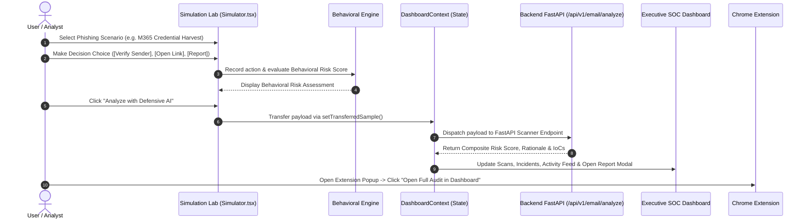
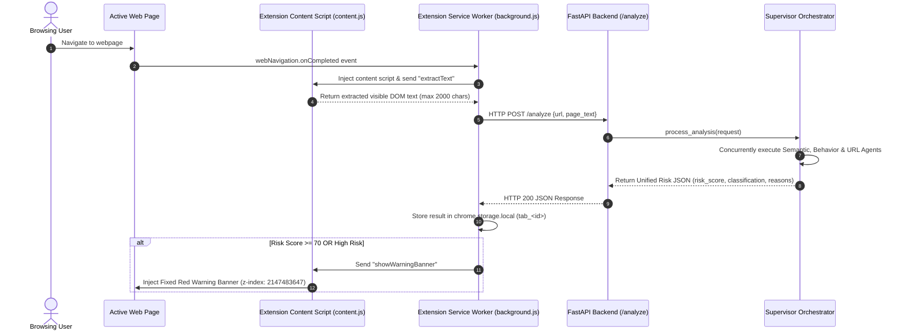

# 🛡️ SemanticShield AI – Project Overview

**Project Title**: *An Intelligent Agent for Phishing Simulation and Behavioral Threat Analysis*  
**Platform Name**: SemanticShield AI  
**Architecture Style**: Agentic Clean Architecture (FastAPI Backend) + Single-Page Application (React + Vite) + Manifest V3 Chrome Extension  

---

## 1. Project Summary

**SemanticShield AI** is an enterprise-grade cybersecurity platform that protects organizations against modern AI-driven social engineering, spear-phishing campaigns, credential harvesting, and brand impersonation attacks. 

The platform combines **real-time edge browser protection** (via a Chrome Extension), an **interactive educational simulation lab**, an **executive Security Operations Center (SOC) dashboard**, and an **agentic multi-agent threat engine** powered by Google Gemini LLMs. It automates the detection, explanation, and reporting of complex threats while actively training users to recognize psychological manipulation.

---

## 2. Problem Statement

Modern cyber threats have evolved beyond static, recognizable spam:
- **Zero-Day & Ephemeral Domains**: Attackers generate single-use phishing domains that evade traditional static blocklists and reputation databases.
- **AI-Generated Social Engineering**: Attackers craft highly personalized, grammatically perfect spear-phishing emails using generative AI models.
- **Psychological Coercion**: Attacks bypass traditional email filters by leveraging authority abuse, artificial urgency, fear tactics, and brand impersonation.
- **Security Awareness Gap**: Employees often receive passive security awareness training that fails to build real-world behavioral resilience against zero-day social engineering vectors.

---

## 3. Solution Overview

SemanticShield AI solves these challenges through a unified, intelligence-driven defense:
1. **Agentic Multi-Agent AI Pipeline**: Concurrently evaluates semantic intent, psychological coercion, and domain/URL technical heuristics to catch zero-day attacks instantly.
2. **Real-Time Browser Edge Guard (Sentinel Web Guard)**: Intercepts active web page DOM text as users browse, rendering real-time risk scores and injecting unignorable warning banners on high-risk sites before credentials can be submitted.
3. **Phishing Simulation & Behavioral Threat Analysis**: Provides an offensive-defensive training sandbox where users interact with realistic threat scenarios. System evaluates employee decisions ([Ignore], [Verify Sender], [Open Link], [Report Phishing]) and provides instant behavioral feedback.
4. **Transparent AI Explainability**: Replaces generic risk scores with clear, human-readable explanations detailing *why* a sample was flagged, identifying key Indicators of Compromise (IoCs), and recommending actionable mitigation steps.

---

## 4. Core Features

### 🌐 URL Analysis
- Deep URL structural heuristic parsing (subdomain count, hyphenation, port anomalies, entropy scoring).
- Typosquatting detection against major brands (e.g. `paypa1`, `micros0ft`).
- Integration with WHOIS domain registration dates, DNS SPF/MX records, and SSL/TLS certificate validation.
- Live Threat Intelligence queries across VirusTotal, AbuseIPDB, and URLScan plugins.

### 📧 Email Analysis
- Full RFC822 `.eml` MIME file upload and raw header/body parsing.
- Detection of Header Display Name Spoofing (e.g. Display Name: `CEO John`, Address: `hacker@external.com`).
- Extraction and validation of embedded links and attachment risk flags.

### 🔌 Browser Extension (Sentinel Web Guard)
- Built on Chrome **Manifest V3** standard (`background.js` service worker + `content.js` content script).
- Scrapes visible headline text and DOM content upon navigation.
- Queries backend `/analyze` endpoint and renders real-time badge counters and glassmorphic popups.
- Injects a fixed red warning banner (`z-index: 2147483647`) on dangerous pages to prevent credential entry.

### 🎯 Phishing Simulation Lab
- Controlled, educational training sandbox featuring 11+ realistic attack vectors (M365 OAuth Token Harvest, Executive Urgent Wire Transfer, HR Payroll Update, MFA Push Fatigue).
- Offers interactive employee decision buttons and 1-click payload transfer to Defensive AI for deep inspection.

### 🎭 Behavioral Threat Analysis
- Psychological coercion analyzer evaluating:
  - **Artificial Urgency**: "24-hour deadline before account suspension".
  - **Authority Abuse**: Spoofed C-suite or IT Lead identities.
  - **Fear & Pressure Tactics**: Immediate legal or security consequences.
- Tracks interactive employee responses ([Ignore], [Verify Sender], [Open Link], [Report Phishing]) and assigns a Behavioral Risk Level.

### 🤖 AI Security Assistant
- Floating interactive SOC chatbot available on the dashboard.
- Uses generative AI to answer technical security questions, explain IoCs, and recommend remediation steps.

### 💻 Executive SOC Dashboard
- Real-time Security Operations Center KPIs: Total Scans, Blocked Threats, Critical Threats, Threat Velocity Gauge, and Detection Accuracy.
- Subsystem health telemetry monitoring WHOIS, DNS, VirusTotal, AbuseIPDB, and URLScan provider latencies.
- Persistent WebSocket feeds broadcasting live security events.

### 📄 Reports & PDF Exports
- Generates Executive Summaries and Technical SOC Incident Reports.
- Multi-format exporter supporting JSON, Markdown, CSV, and STIX 2.1 threat intelligence standards.

### 📜 Scan History & Audit Trail
- Filterable and searchable incident history table (`Incidents.tsx`).
- Allows analysts to filter by severity, threat type, date range, or keyword.

---

## 5. System Architecture

SemanticShield AI utilizes a three-tier decoupled architecture:

```
+-----------------------------------------------------------------------+
|                         EXECUTIVE CLIENT TIER                         |
|  +--------------------------------+   +----------------------------+  |
|  | React Executive SOC Dashboard  |   | Sentinel Web Guard Ext.    |  |
|  | (Vite + TypeScript + Tailwind) |   | (Chrome Manifest V3)       |  |
|  +--------------------------------+   +----------------------------+  |
+-----------------------------------:-----------------------------------+
                                    | REST / WebSockets / JSON
+-----------------------------------v-----------------------------------+
|                        FASTAPI BACKEND GATEWAY                        |
|  (backend/app/main.py -> app/api/v1/router.py -> app/orchestrator)    |
+-----------------------------------:-----------------------------------+
                                    | Async Fan-out (asyncio.gather)
+-----------------------------------v-----------------------------------+
|                     AGENTIC MULTI-AGENT ENGINE                        |
|  +---------------------+ +--------------------+ +------------------+  |
|  | Supervisor Agent    | | Semantic AI Agent  | | Behavior Agent   |  |
|  | (Orchestrator)      | | (Gemini LLM)       | | (Coercion)       |  |
|  +---------------------+ +--------------------+ +------------------+  |
|                          +--------------------+                       |
|                          | URL Intel Agent    |                       |
|                          | (Heuristics + TI)  |                       |
|                          +--------------------+                       |
+-----------------------------------:-----------------------------------+
                                    | Plugin Registry
+-----------------------------------v-----------------------------------+
|                 THREAT INTEL & DIAGNOSTIC PLUGINS                     |
|    [WHOIS Lookup]   [DNS Inspector]   [SSL Validator]   [VirusTotal]   |
+-----------------------------------------------------------------------+
```

---

## 6. End-to-End System Flows

### Flow 1: Simulation → Behavior → Analysis → Report → Dashboard → Extension



### Flow 2: Extension → Backend → Analysis → Result


